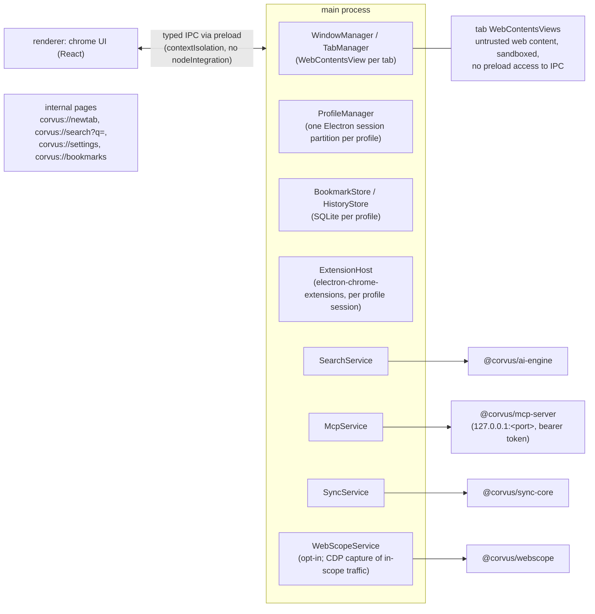

# Corvus Architecture

Corvus is a daily-use desktop browser that is also an **MCP server**, so AI agents (Claude Code, Claude Desktop, any MCP client) can drive it, and whose search box is answered by an **AI search engine** instead of a conventional search page.

## 1. Engine choice

| Option | Pros | Cons | Decision |
|---|---|---|---|
| Chromium fork | Full control, native extension support | ~100 GB checkout, 4–8 h builds, Windows build needs MSVC + Windows SDK on a Windows host, weekly security rebases | Phase 2 (optional) |
| **Electron** (Chromium + Node) | Same Blink/V8 engine, cross-platform, `.exe` buildable from Docker (wine), Chrome extensions via `electron-chrome-extensions` + `electron-chrome-web-store` | Partial `chrome.*` API coverage, bigger memory per window | **Phase 1** |

All browser features talk to the `BrowserController` contract (`packages/shared`), so a later move to a Chromium fork replaces the shell, not the AI/sync/MCP layers.

## 2. Repository layout

```
apps/desktop          Electron shell: tabs, groups, omnibox, bookmarks, profiles, extensions, settings UI
packages/shared       Contracts: BrowserController, SearchEngine, sync protocol types
packages/ai-engine    Retrievers (SearXNG/Brave/DDG) + AI providers (Anthropic API / Claude Code CLI) + cache
packages/mcp-server   MCP server (Streamable HTTP on 127.0.0.1 + stdio bridge) over BrowserController
packages/sync-core    E2E crypto (BIP39, HKDF, XChaCha20-Poly1305, Ed25519) + sync client
packages/webscope     Security workbench engine: scope, capture, repeater, fuzzer, rules, HAR (see docs/WEBSCOPE.md)
services/sync-server  Self-hostable sync server (Fastify + SQLite), stores only ciphertext
docker/               Dev toolchain image, SearXNG config, Windows builder
```

## 3. Process model (desktop)



## 4. AI search (token budget first)

1. Omnibox classifies input: URL → navigate; else → `corvus://search?q=`.
2. Retriever gets top N results **without any LLM** (SearXNG self-hosted by default).
3. Results render immediately (classic list, zero tokens).
4. One call to a small model (default `claude-haiku-5-5`) with a compact prompt: numbered snippets (≤ 300 chars each), answer language, "cite as [n]". Output capped (~400 tokens).
5. `deep` mode (opt-in button) fetches the top 3 pages, Readability-extracts, trims to ~1.5k chars each.
6. LRU + on-disk cache keyed by (normalized query, lang, depth) with TTL.
7. Language: explicit setting > detected query language (`franc-min`) > UI locale.

Providers:
- `anthropic-api` — official SDK with the user's API key. Prompt caching on the system prompt.
- `claude-code-cli` — spawns local `claude -p --output-format stream-json` using the user's own Claude Code login. Personal-use only: Anthropic consumer subscriptions may not be resold or embedded into apps distributed to others; distributed builds must use API keys.

## 5. MCP server

- Transport: Streamable HTTP on `127.0.0.1` only, random port persisted in settings, bearer token shown in Settings → AI Agents (copyable `claude mcp add` command).
- Tools: `tabs_list, tab_open, tab_close, tab_activate, navigate, back, forward, reload, group_create, ungroup, page_snapshot, click, type, scroll, screenshot, bookmarks_list, bookmark_add, history_search, web_search` (+ `evaluate` only if enabled by the user).
- Safety: per-client permission prompt on first connection; agent-driven tabs get a visible AI badge; page content returned to agents is wrapped as untrusted data; no file:// or corvus://settings access for agents. A click, submit or workflow step that spends money (shared rules in `packages/shared/src/spend.ts`) shows a native "Allow once / Deny" dialog at every access level (`packages/mcp-server/src/spend-gate.ts`, `controller.confirmSpend`).

## 6. Sync (Brave-Sync-like)

See `packages/shared/src/sync.ts`. Zero-knowledge: the server stores opaque ciphertext. Restore = enter the 24-word phrase on a new device. Server is self-hosted via Docker. One chain per profile; collections bookmarks, history, settings (allowlist), profiles, open_tabs and extensions (suggestions only). Details in `apps/desktop/README.md#sync`.

## 7. Build & release

- Dev: everything runs in `docker compose run --rm dev …` (no Node on host required).
- Windows: `docker compose run --rm builder` → `electron-builder --win` inside `electronuserland/builder:wine` → `release/Corvus-Setup-x.y.z.exe` (NSIS) + portable.
- Linux: AppImage/deb from the same container. macOS: a universal `.dmg` built on a Mac build host over SSH, signed with the Developer ID and notarized (see docs/RELEASE.md).
